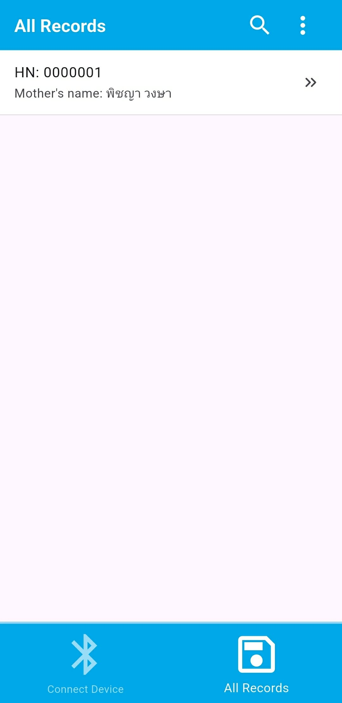
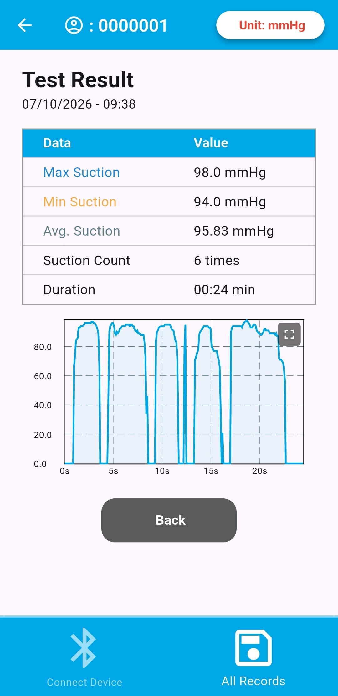
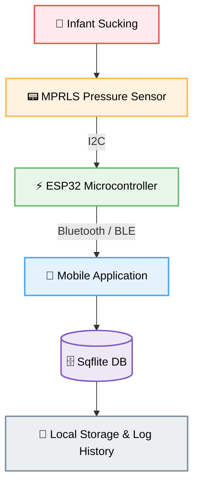

# Baby Suction Tracker Prototype Version 2

ระบบวัดและประเมินแรงดูดทารกแรกเกิดแบบเรียลไทม์ผ่านการเชื่อมต่อไร้สาย (Flutter + ESP32)


## 📸 Application Preview

### 1. Patient Selection & Test Setup
|                       Baby Directory                        |                          Unit Selection                          |                        Test Configuration                        |
| :---------------------------------------------------------: | :--------------------------------------------------------------: | :--------------------------------------------------------------: |
|  |  |  |
|                      รายชื่อและประวัติทารก                      |                          เลือกหน่วยการวัด                           |                     ตั้งค่าพารามิเตอร์ก่อนการทดสอบ                     |

### 2. Real-time Measurement & Result Summary
|                       Real-time Monitoring                       |                        Fullscreen Interactive Graph                        |                   Measurement Summary                   |
| :--------------------------------------------------------------: | :------------------------------------------------------------------------: | :-----------------------------------------------------: |
|  |  |  |
|                      แสดงค่าแรงดูดสดขณะทดสอบ                       |                          วิเคราะห์กราฟแรงดูดแบบเต็มจอ                          |               สรุปผลดัชนีการดูดหลังจบ Session                |

### 3. Log History & Multi-Session Comparison (v2 Core Feature)
|                                Detailed History Log                                |                        Multi-Graph Comparison                        |
| :--------------------------------------------------------------------------------: | :------------------------------------------------------------------: |
|  |  |
|                           ย้อนดูรายละเอียดประวัติการวัดแต่ละครั้ง                           |                     ซ้อนทับกราฟเพื่อเปรียบเทียบพัฒนาการ                     |

---

## 📌 Background & Motivation
การประเมินศักยภาพการดูดนมของทารกคลอดก่อนกำหนด (Preterm Infant) มีความสำคัญอย่างยิ่งต่อการตัดสินใจในการเปลี่ยนผ่านขั้นตอนการให้นม 

* **ปัญหาจากวิธีดั้งเดิม:** บุคลากรทางการแพทย์ใช้นิ้วมือสัมผัสการดูดของทารกโดยตรง ซึ่งอาศัยความรู้สึกส่วนบุคคล (Subjective) ทำให้ผลการประเมินมีความคลาดเคลื่อนและขาดมาตรฐาน
* **ปัญหาของอุปกรณ์ในท้องตลาด:** เครื่องมือวัดระดับการแพทย์ที่มีอยู่มักมีราคาสูงมาก ไม่สามารถบันทึก Data Log ดิจิทัลเพื่อติดตามพัฒนาการระยะยาวได้ หรือขาดการเชื่อมโยงกับระบบพกพาสมัยใหม่

โปรเจกต์นี้จึงถูกพัฒนาขึ้นเพื่อสร้าง **อุปกรณ์ IoT วัดแรงดูดต้นแบบที่มีความเที่ยงตรงสูง ราคาจับต้องได้ และบันทึกผลผ่าน Mobile Application ได้อย่างสมบูรณ์**

---

## 🚀 What's New in Version 2 (Engineering Upgrades)

ในเวอร์ชัน 2 นี้ ได้ทำการรื้อระบบเพื่อแก้ไขข้อจำกัดทางเทคนิคและสถาปัตยกรรมข้อมูลจากเวอร์ชันแรก (v1) ดังนี้:

| หัวข้อ (Topic)            | Version 1 (Prototype)             | Version 2 (This Project)                | เหตุผลในการอัปเกรด (Rationale)                                                                                   |
| :---------------------- | :-------------------------------- | :-------------------------------------- | :------------------------------------------------------------------------------------------------------------- |
| **Sensing Technology**  | FSR402 (Force Sensitive Resistor) | **MPRLS Micropressure Sensor**          | FSR402 วัดแรงกด (Push) ซึ่งไม่ตรงกับสรีรวิทยาการดูด (Negative Pressure/Vacuum) เซ็นเซอร์ MPRLS จึงให้ค่าแรงดูดที่ตรงความเป็นจริง |
| **Data Management**     | In-Memory / Limited State         | **Sqflite (Local SQLite Database)**     | เดิมเก็บบันทึกประวัติได้สูงสุดเพียง 2 รายการ เวอร์ชัน 2 จึงจัดโครงสร้าง DB ใหม่ให้บันทึกได้ไม่จำกัด                                   |
| **Historical Analysis** | เปรียบเทียบกราฟได้เฉพาะ 2 ครั้งล่าสุด    | **Flexible Multi-Log Graph Comparison** | ให้บุคลากรทางการแพทย์ย้อนดูประวัติเป็นรายการ และเลือกกราฟบันทึกคราวก่อนๆ มาเปรียบเทียบกันได้อิสระ                               |
| **App Architecture**    | Basic UI / Single Flow            | **Modular Architecture (Rebuilt)**      | ออกแบบแอปพลิเคชันใหม่ทั้งหมดเพื่อที่เหมาะสมแก่การใช้งานจริง                                                                |

---

## 🛠 System Architecture & Tech Stack



---

### **Hardware & Embedded System**
* **Microcontroller:** ESP32 (Low Power, Built-in BLE/Bluetooth)
* **Pressure Sensor:** Adafruit MPRLS Ported Pressure Sensor
* **Communication:** Bluetooth Serial / BLE Protocol

### **Mobile Application**
* **Framework:** Flutter 
* **Database Management:** Sqflite (SQLite plugin) สำหรับจัดการ Relational Data โลคอลภายในเครื่อง
* **Data Visualization:** Custom Interactive Graphing Library (รองรับ Multi-graph Overlay)

---

## 🛠️ Tech Stack & Why

| Technology                                                                                                    | Category                  | Why We Chose It                                                                                  |
| :------------------------------------------------------------------------------------------------------------ | :------------------------ | :----------------------------------------------------------------------------------------------- |
|  | **Microcontroller**       | รองรับ Bluetooth/BLE ในตัว, ประมวลผลไว, ประหยัดพลังงาน และเหมาะสำหรับอุปกรณ์ IoT ขนาดเล็ก                 |
|             | **Wireless Connectivity** | บริโภคพลังงานต่ำมาก (Low Energy) ปลอดภัยต่อการใช้งานใกล้ชิดทารก และส่งข้อมูลแบบ Real-time Latency ต่ำ          |
|       | **Mobile Framework**      | พัฒนาแอปได้แบบ Cross-Platform (iOS & Android) จาก Codebase เดียว และเรนเดอร์ UI/Graph ได้ลื่นไหล        |
|                | **Programming Language**  | เป็นภาษา Strongly-typed และรองรับ Asynchronous/Stream ได้ดีเยี่ยม เหมาะกับการรับข้อมูลจาก Sensor แบบต่อเนื่อง |
|        | **Local Database**        | ฐานข้อมูล SQLite น้ำหนักเบาบนมือถือ ช่วยเก็บบันทึกประวัติค่าแรงดูด (Log History) ได้แบบ Offline สะดวกรวดเร็ว      |

---
## ✨ Key Features

1. **Real-Time Pressure Measurement:** แสดงค่าแรงดูดสดจากเซ็นเซอร์ผ่านการเชื่อมต่อ Bluetooth พร้อมแสดงผลเป็นกราฟ Real-time
2. **Clinical Session Logging:** บันทึก session การวัดผลลงใน local database พร้อมระบุ Timestamp และ Note เพิ่มเติม
3. **Unlimited History Directory:** ระบบจัดเก็บประวัติย้อนหลัง ค้นหา และดูรายละเอียดย่อยของการวัดแต่ละครั้งได้ไม่จำกัด
4. **Customizable Graph Comparison:** เลือกประวัติการดูดของทารกจากหลายๆ ช่วงเวลามาซ้อนทับเพื่อเปรียบเทียบพัฒนาการ (Trend Analysis)

---

## 🗁 Project Structure of Application
```plaintext
application/
├── 📁 android/                                 # Android Platform Config
├── 📁 ios/                                     # iOS Platform Config
├── 📁 lib/                                     # 💡 Source Code หลักของแอปพลิเคชัน
│   ├── 📄 main.dart                            # Entry point หลักของโปรแกรม
│   │
│   ├── 📁 pages/                               # ส่วนแสดงผลหน้าจอ (UI / Screens)
│   │   ├── 📁 babies/                          # หน้าจอจัดการข้อมูลเด็กและการทดสอบ
│   │   │   ├── babies_list.dart
│   │   │   ├── baby_route_hub.dart
│   │   │   ├── baby_test_history.dart
│   │   │   ├── comparision_test_history.dart
│   │   │   ├── during_test.dart                # หน้าขณะทำการทดสอบแรงดูด
│   │   │   ├── setup_test.dart                 # หน้าตั้งค่าการทดสอบ
│   │   │   ├── specific_test_history.dart
│   │   │   └── sumary_test.dart                # หน้าสรุปผลการทดสอบ
│   │   │
│   │   └── 📁 bluetooth/                       # หน้าจอการเชื่อมต่ออุปกรณ์ Bluetooth
│   │       ├── connected_device.dart
│   │       └── finding_devices.dart
│   │
│   └── 📁 services/                            # Logic, State Management & Backend Handlers
│       ├── babies_list_dialog_handler.dart
│       ├── ble_handler.dart                    # ตัวจัดการ Bluetooth Low Energy (BLE)
│       ├── database_handler.dart               # ตัวจัดการฐานข้อมูล SQLite (Sqflite)
│       ├── suction_test_handler.dart           # ตัวประมวลผล Logic การทดสอบแรงดูด
│       └── ui_helper.dart                      # Helper Utilities สำหรับจัดการ UI
│
├── 📁 assets/                                  # Static Resources ของแอป
│   ├── 📁 images/                              # รูปภาพประกอบภายในแอป
│   └── 📁 translations/                        # ไฟล์แปลภาษา (Multi-language / i18n)
│       ├── en.json                             # ภาษาอังกฤษ
│       └── th.json                             # ภาษาไทย
│
├── 📁 images/                                  # โลโก้โปรเจกต์และภาพประกอบ README
├── 📁 test/                                    # Unit & Widget Testing
├── 📄 analysis_options.yaml                    # กฎการตรวจ Linting Rules (Dart)
└── 📄 pubspec.yaml                             # ไฟล์กำหนด Dependencies & Packages
```

## 👥 Team Members

<table>
  <tr>
    <td align="center" width="200">
      <a href="https://github.com/Zag5A6167">
        <br />
        <sub><b>นายชาคริตส์ แก้วมูลเมือง</b></sub>
      </a><br />
      <sub>Firmware & Hardware</sub>
    </td>
    <td align="center" width="200">
      <a href="https://github.com/soraphu">
        <br />
        <sub><b>นายสรภูริ์ ทองจันทร์</b></sub>
      </a><br />
      <sub>Mobile App Lead</sub>
    </td>
    <td align="center" width="200">
      <a href="https://github.com/showkun396">
        <br />
        <sub><b>นายภูมิรพี กาวันนา</b></sub>
      </a><br />
      <sub>Technical Documentation Lead</sub>
    </td>
  </tr>
</table>

## 🎓 Project Details

| Role / Details      | Information                              |
| :------------------ | :--------------------------------------- |
| **Project Advisor** | ผศ.อนันท์ ทับเกิด (Asst. Prof. Anan Tubkeaw) |
| **Institution**     | มหาวิทยาลัยเทคโนโลยีราชมงคลล้านนา (RMUTL)    |
